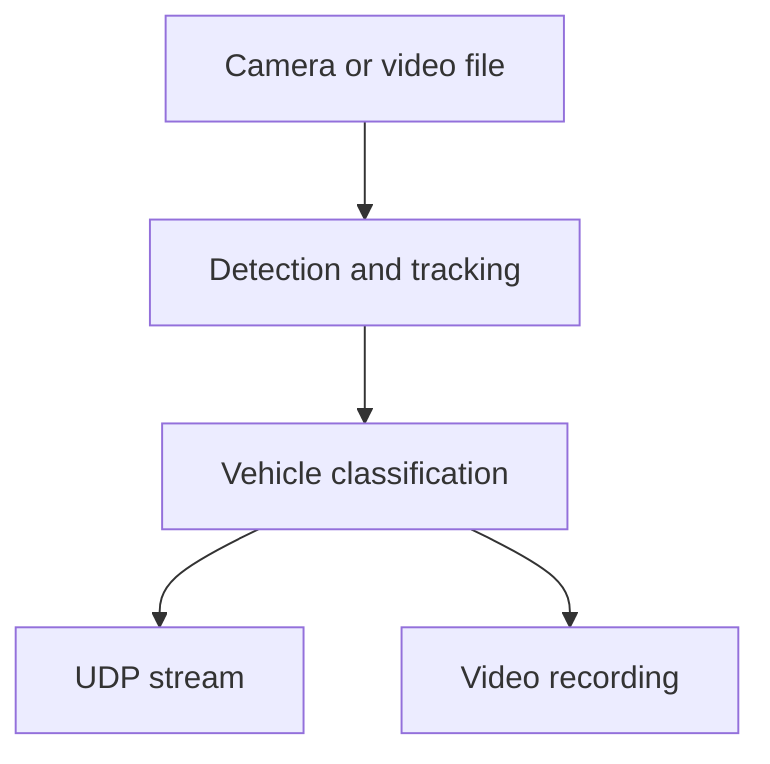

# Junior Ruiz Sánchez

**Electrical Engineer · Computers and Networks**  
University of Costa Rica · Costa Rica

I enjoy connecting software with physical systems. My work spans embedded Linux,
microcontrollers, robotics and digital design, with projects in multimedia,
control and connected devices. I like understanding how things work, building
tools and documenting what I learn.

**[Explore my interactive portfolio →](https://jrpompio.github.io/)**

## Tools I work with

| Area | Technologies |
| --- | --- |
| Software | Python, C, C++, Git, Bash, PySide6 / Qt |
| Embedded systems | Linux, Docker, cross-compilation, Raspberry Pi, Jetson Nano, STM32, ESP32, libopencm3 |
| Multimedia & robotics | GStreamer, DeepStream, ROS 2, USB, UART, SPI, I²C |
| Digital design | Verilog, Icarus Verilog, GTKWave, Yosys; academic VLSI work with Synopsys tools |
| Networks & control | BLE, Wi-Fi, UDP, OSPF, VLANs, MATLAB, PI control |

I also use Codex, Claude Code and Antigravity as development assistants.

## Selected projects

### Embedded video processing · Jetson Nano

**Academic team project · C, Linux, GStreamer, DeepStream**

Developed a video application for object detection, tracking and vehicle brand
classification on NVIDIA Jetson Nano. The system supports UDP streaming and
hardware-accelerated recording.

### Open-CoRoCo · ArcosLab contributions

**Collaborative contributions · Embedded C, libopencm3, ROS 2**

Improved temperature calculation, aligned USB communication and input handling
with `libopencm3-plus`, tested motors and an AS5047P-TS sensor, and corrected an
odometry bug in ROS 2.

### Educational robotics · Kinect v2 integration

**Collaborative contributions · ROS 2, Raspberry Pi 5**

Contributed packaging, dependency configuration and documentation for a Kinect v2
driver in ROS 2 on Raspberry Pi 5. Also designed a modular sensor slot for an
educational robot.

[Driver fork and contributions →](https://github.com/jrpompio/kinect2ros)

### Digital security controller · Verilog

**Academic project · Finite-state machines, Icarus Verilog, GTKWave**

Designed a controller for door, window, motion and smoke inputs, with timed entry
sequences and alarm outputs. Documented seven simulation scenarios with waveforms.
A valid-password pulse and timer expiry are inputs to the controller.

[Source, simulation scenarios and waveforms →](https://github.com/jrpompio/sistema-seguridad-verilog)

### Small-scale vehicle · Raspberry Pi

**University community service · Python, motors, servos, GUI**

Developed control software for a small vehicle using a Raspberry Pi and Xbox
controller, with a graphical interface for non-technical users. Tested and refined
the system on hardware.

## More projects

Software, digital design, electronics and connected systems

| Project | What I worked on | Code / details |
| --- | --- | --- |
| BLE–Wi-Fi provisioning | Python BLE GATT server on Linux, ESP32 client, PyQt5 interface and Bash startup scripts | [Repository](https://github.com/jrpompio/ProyectoTeleco) |
| Airflow control | Plant identification, PI tuning, simulation and experimental testing for a hot-air soldering station | [Repository](https://github.com/jrpompio/proyectouwu) |
| VLSI implementation | Academic logic synthesis and physical design of an Amber SoC using Synopsys tools | [Repository](https://github.com/jrpompio/ProyectoVLSI) |
| Digital design exercises | Verilog state machines, testbenches and synthesis | [Repository](https://github.com/jrpompio/Circuitos-Digitales-II) |
| Ethernet PCS | Team design of a 1000BASE-X Physical Coding Sublayer in Verilog | [Portfolio](https://jrpompio.github.io/) |
| FPGA communication | Python UART client, opcode parsing and RGB565 image conversion for a Nexys A7 / RvFPGA project | [Portfolio](https://jrpompio.github.io/) |
| Bare-metal microcontrollers | Academic C and assembly work in the microcontrollers laboratory | [Repository](https://github.com/jrpompio/IE0624_LAB_microcontroladores) |
| Home automation | Raspberry Pi Pico and ESP32, Telegram control, sensor reporting and Wake-on-LAN | [Portfolio](https://jrpompio.github.io/) |
| Analog humidity sensor | Low-power op-amp circuit with threshold-based LED indicators | [Portfolio](https://jrpompio.github.io/) |
| Audio-based function generator | Signal protection and amplification using an LM358 | [Portfolio](https://jrpompio.github.io/) |
| Whack-A-Mole | Python, GTK / PyGObject and Pygame; object-oriented design, settings and persistent scores | [Portfolio](https://jrpompio.github.io/) |
| Connect Four | C++ game developed for a data structures and algorithms course | [Repository](https://github.com/jrpompio/4enLinea_IE0217_Proyecto) |

## Beyond the code

At **Boston Scientific**, my process engineering internship includes dimensional
measurements, data collection, statistical analysis in Minitab and technical
documentation. I also developed a Python / PySide6 image-capture tool for a
USB-C borescope to support data collection.

I have also supported mathematics teaching and tutoring at the **University of
Costa Rica**. These experiences complement my technical work with testing,
clear documentation and communication.

---

[Portfolio](https://jrpompio.github.io/) · [LinkedIn](https://www.linkedin.com/in/jr-ruiz/)
